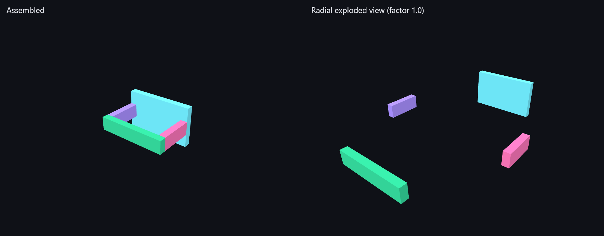

# step-exploded-view-api

**Status: prototype.** A small REST API and web viewer to read a STEP assembly and compute a *radial* exploded view: the result comes as JSON and as glTF 2.0 (assembled and exploded).

This was the first module of my master's project on exploded views of CAD assemblies. It is kept as a simple, self-contained service: upload a STEP file, get the parts with their geometry and an exploded layout to display.



*Generated `bracket` sample (4 parts, `python -m step_explode.samples`), rendered by the built-in three.js viewer. On the left the assembled state, on the right the radial explosion with factor 1.0. The viewer's slider moves between the two.*

> The radial explosion **does not check for interference**. Nested or coaxial parts (a cover on a shaft, a pin in a hole) usually still collide after it. For a geometric check and repair, see [cad-exploded-view-verifier](https://github.com/ayoub-elkhader/cad-exploded-view-verifier).

## How it works

1. **Parse** (`parser.py`, pythonocc-core). Every solid of the STEP file becomes one component. For each component the parser extracts the bounding box, centre, size, volume, centre of mass, number of faces and a triangle mesh.
2. **Explode** (`explode.py`, pure Python). Each component moves away from the mean of all centres, along the direction to its own centre, by `factor ×` its own bounding-box diagonal. A component exactly at the centre moves along +Y.
3. **Export** (`gltf.py`, pure Python). It writes two glTF files with embedded buffers. Vertices are stored relative to each part centre, and only the node translations differ between the assembled and exploded files.
4. **Serve** (`api.py`, FastAPI) and **view** (`static/viewer.html`, three.js r128 from cdnjs). The viewer has a slider between the assembled and exploded states.

## Installation

`pythonocc-core` is distributed through conda-forge only.

```bash
conda env create -f environment.yml
conda activate step-explode
```

## Usage

```bash
# generate two small synthetic STEP assemblies (bracket, flange)
python -m step_explode.samples samples/

# command line
step-explode samples/flange.step --factor 2.5 --out-dir out/

# API + viewer
uvicorn step_explode.api:app --port 8000
# open http://127.0.0.1:8000, choose a .step file, "Upload and explode"
```

| Endpoint | Description |
|---|---|
| `POST /api/upload` | multipart `.step` / `.stp` file → `job_id` + components |
| `POST /api/jobs/{job}/explode?factor=2.5` | radial explosion → components with `explode_vector` and `exploded_position` |
| `GET /api/jobs/{job}` | last result (JSON) |
| `GET /api/jobs/{job}/gltf/{assembled\|exploded}` | glTF 2.0 |
| `GET /api/health` | status |

Configuration uses environment variables (see `.env.example`):
- `STEP_EXPLODE_WORKDIR`: storage folder;
- `STEP_EXPLODE_MAX_MB`: upload limit, default 50;
- `STEP_EXPLODE_CORS`: allowed origins, none by default.

Uploaded files are stored under a random job id. The client file name is never used as a path.

## Demo

I checked the viewer in a browser with the generated `flange` sample (3 parts). The upload, explosion and display all work. The demo also shows the limitation: the flange plate moves away, but the cover stays on the shaft, because they share the same centre line.

## Tests

```bash
pytest
```

14 tests pass locally (Windows 10, Python 3.10, pythonocc-core 7.9.0):
- the explosion algorithm and the glTF writer, in pure Python: vector directions and magnitudes, buffer round trip, 4-byte alignment;
- STEP parsing of generated assemblies: exact size, centre, volume and face count of a 100 × 60 × 10 mm plate, plus meshes;
- the CLI;
- the full API flow with FastAPI's test client, including rejected uploads and invalid job ids.

CI runs them on Python 3.10–3.12 with conda-forge.

## Limitations

- **Radial heuristic only.** There is no collision check, no disassembly logic and no use of the product structure, names or materials of the STEP file.
- **Every solid is a part.** A part modelled as several solids is split.
- **Simple job storage.** Jobs are kept on disk without expiry or authentication, so this is a local or demo service, not a production one.
- **The viewer needs internet access** to load three.js from cdnjs.

## License

MIT, see [LICENSE](LICENSE).
